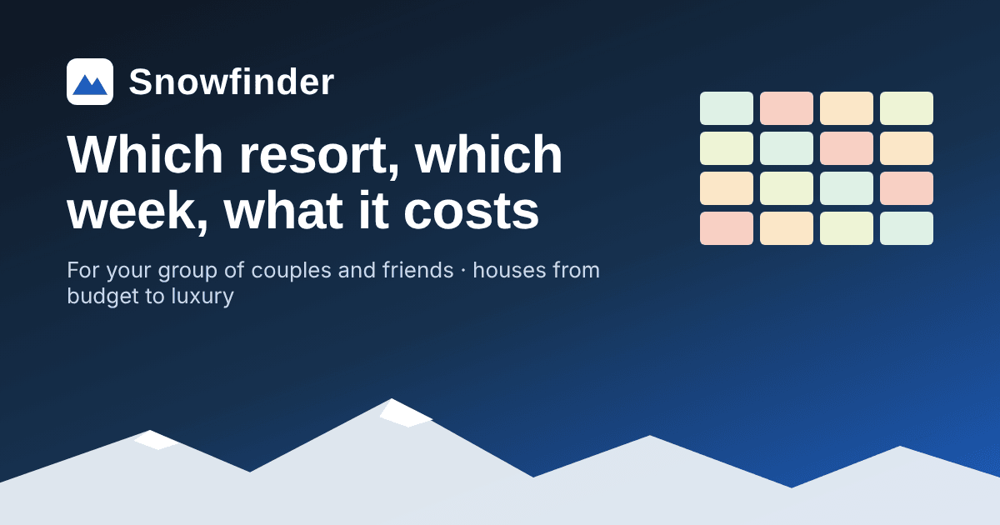

# Snowfinder

**Which ski resort, which week, and what it really costs for your group.**

Snowfinder compares a 5-night ski trip at 6 resorts in the Alps and Andorra, week by week,
for a group of couples and friends. Each price per person adds up flights, rental car or transfer, the
house, lift pass, ski rental, food and lessons. It shows the cheapest week for every resort, then
Budget / Mid / Luxury houses that actually fit your group, with photos.



- **Your group**: couples + solo friends (twin rooms or their own). This sets the bedrooms needed, how many
  cars or transfer vans you need, and how lessons and the house split per person.
- **Week grid**: every resort × every week from late January to mid-April, coloured cheapest → priciest,
  with school-holiday peaks, closing dates and spring-snow warnings.
- **Houses by level**: real listings split into the cheapest, middle and priciest third. Each level shows
  its typical (median) price and its best-rated house nearest the lifts.
- **Editable**: type in a real quote for any week and it replaces the estimate.
- **Share**: one link carries your whole plan (group, week, prices you typed) to your friends.
- **Telegram votes** (optional): a bot that runs the group's decisions with agreed thresholds and deadlines.
  See [`bot/`](bot/README.md).

Flights are from Porto (OPO); the origin is a setting in the season file, so a fork can use any airport.

## Where's the backend?

There is no server for the site. Everything is calculated in the browser.

```
data/listings.csv ─┐                       ┌─────────────────────────┐
Google Sheet (opt) ┴─► weekly GitHub Action ─► data/generated/listings.json
                       (pipeline/, Python)  │  data/resorts.json        │─► esbuild ─► GitHub Pages (static)
                                            │  data/season-2027.json    │
                                            └─────────────────────────┘
Telegram group ◄──► Cloudflare Worker + D1 (bot/, optional, free tier)
```

- **Data** lives in the repo as JSON/CSV, so changes are pull requests with a history.
- **The pipeline** (`pipeline/`) validates the curated house list, merges quotes for the same house, fills
  in missing photos from the listing page where it can, and only commits when something changed. A paid or
  official listing API can be added later as another provider (`pipeline/providers/base.py`).
- **The bot** is the only always-on part, because votes need to close on time. It runs on Cloudflare's
  free tier.

## How the cost model works

| Part | How it's calculated |
|---|---|
| Flight | per person, × demand (−10% low … +35% peak) |
| Car | per car × ⌈people ÷ 5⌉ cars, split over the group |
| Transfer | per vehicle; one per 8 people, a 5–8 seat van costs ×1.4 |
| House | median of the chosen level's fitting houses, otherwise a 2-bedroom estimate × (bedrooms ÷ 2)<sup>0.9</sup> |
| Lift pass, rental | per person, fixed for the season |
| Food | € per person per day × 6 days |
| Lessons | price per day × ski days × beginners, shared over the group |

Demand levels per week come from the 2027 school holidays of the countries that ski at each resort.
House quotes for other dates are converted through the same multipliers. A house "fits" when it sleeps
everyone and has between the needed number of bedrooms and two more.

The model was ported from a single-file prototype; `tests/golden.test.ts` checks it against 10,368 prices
from that prototype, and they match exactly.

## Run it locally

Needs Node 22.18+ (for the tests) and Python 3.11+ (only for the listings pipeline).

```bash
npm install
npm run dev          # http://localhost:8000, rebuilds on save
npm test             # model, houses, share links, parity with the prototype
npm run build        # → dist/

pip install -r pipeline/requirements.txt
python -m pytest -q                      # pipeline tests
python -m pipeline.build_listings        # rebuild data/generated/listings.json
```

## Deploy your own copy

1. Fork or push this repo to GitHub.
2. **Settings → Pages → Source: GitHub Actions.** Every push to `main` builds and deploys the site.
3. Optional: friends add houses in a Google Sheet. **File → Share → Publish to web → CSV**, then save the
   link as the repository secret `LISTINGS_SHEET_URL`. The weekly *Refresh house listings* job picks it up
   (or run it by hand from the Actions tab).
4. Optional: the Telegram vote bot, see [bot/README.md](bot/README.md).

## Contributing

Adding a house, a resort or next season's prices: see [CONTRIBUTING.md](CONTRIBUTING.md).

## Roadmap

- A Claude-powered assistant in the Telegram group that answers "cheapest week for Soldeu for 9 of us?"
  from this data and opens votes for you.
- More origins than Porto.

## Licence

Code: [MIT](LICENSE). Data in `data/`: [CC BY 4.0](DATA_LICENSE.md). Prices are estimates collected in
October 2026, so check real dates before booking. Not affiliated with Airbnb, Booking.com or any resort.
House photos are shown from each listing and belong to their owners.
